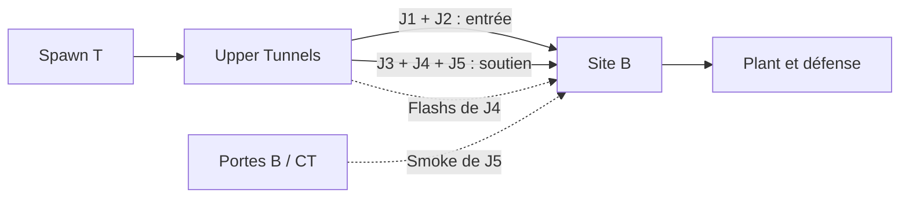

# Sortie rapide B

## Objectif

Prendre le site B à cinq par Upper Tunnels, en avançant ensemble derrière deux flashs.
Les timings sont indicatifs : le signal du leader prime sur le chronomètre.

## Stuffs

- 1 smoke
- 1 molotov
- 3 flashs au minimum

## Spawns

- Au moins 3 spawn B 

##  Rôles

- J1 entry
- J2 second entry et trade
- J3 porteur de bombe
- J4 support flash
- J5 arrière-garde et smoke

## Etapes

1. **0:00–0:12 — Rejoindre Upper Tunnels**
  - J1 et J2 courent en tête ; J3 suit avec la bombe ; J4 reste derrière eux ; J5 ferme la marche et surveille le dos.
  - **Avant l’action**: aucune smoke ni molotov. J4 garde ses flashs.
  - **Consigne**: restez suffisamment proches pour échanger un kill, sans vous bloquer dans le passage.
2. **0:12–0:18 — Préparer la sortie B**
  - J1 et J2 se placent à l’entrée de la sortie ; J3 attend derrière ; J4 prépare sa flash ; J5 couvre l’arrière.
  - **Avant l’action**: J4 annonce puis lance une flash haute vers le site. J1 lance une molotov dans le coin proche de la sortie si ce coin est accessible.
  - **Consigne**: J1 et J2 entrent dès l’explosion de la flash ; J3 suit sans dépasser les entries.
3. **0:18–0:27 — Entrer et planter**
  - J1 entre et vérifie le fond du site ; J2 le suit et couvre le côté opposé ; J3 plante dès que la zone est contrôlée ; J4 accompagne et aide au trade ; J5 avance jusqu’au site.
  - **Avant l’action**: J4 lance une seconde flash vers le fond du site si les entrées sont ralenties. Une fois la sortie franchie et sécurisée, J5 lance sa smoke vers les portes B / CT pour retarder la reprise.
  - **Consigne**: annoncez les angles vérifiés. Ne plantez pas tant qu’un défenseur peut vous voir librement.
4. **0:27+ — Défendre la bombe**
  - J1 et J2 jouent en binôme sur le site ; J3 se place à couvert avec vue sur la bombe ; J4 soutient depuis une position voisine ; J5 surveille le retour par tunnels.
  - **Avant l’action**: aucune smoke ni molotov obligatoire. J4 conserve sa dernière flash pour interrompre la reprise ou aider un équipier à reprendre un duel.
  - **Consigne**: jouez à deux sur le contact et évitez les duels isolés.

## Plan B

Si une molotov bloque la sortie des tunnels ou si l’équipe perd son premier joueur sans pouvoir le trader, ne traversez pas la fumée ou les flammes.
Reculez ensemble, attendez leur dissipation, puis ressortez sur la flash restante.
Si les défenseurs sont toujours trop nombreux, revenez par tunnels et dirigez-vous ensemble vers A par Short ; gardez la bombe au milieu du groupe.

