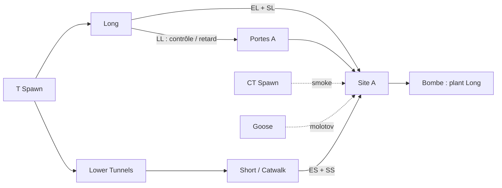

# Split A, fast exec

## Objectif

Prendre A avant que la défense ne s’installe.
Trois joueurs prennent Long, deux passent par Short, puis entrée synchronisée à ~0:22

## Stuffs

- 5 smokes
- 2 molotovs
- 4 flashs

## Spawns

- Au moins un spawn favorable vers Long

##  Rôles

- Entry Long (EL)
- Support Long (SL)
- Lurker Long (LL)

- Entry Short (ES)
- Support Short (SS)

## Etapes

1. **0:00–0:08 — Prise de Long**
  - **Rôles**: EL ouvre Long ; SL suit en trade ; LL garde le dos et prépare la smoke cross. ES et SS courent vers Lower Tunnels.
  - **Avant l’action**: SL lance une flash haute au-dessus de Long ; EL molotov Pit/coin gauche ; LL smoke le cross CT depuis T Spawn.
  - **But**: contrôler Long sans s’arrêter pour chercher des duels inutiles.
2. **0:08–0:18 — Installation Short**
  - **Rôles**: EL/SL avancent jusqu’aux portes A ; LL reste Long pour surveiller le flank. ES prend Short ; SS le suit à distance de trade.
  - **Avant l’action**: ES lance une flash au-dessus de Short ; SS molotov Goose ; SL conserve une flash pour l’entrée.
  - **But**: ne pas montrer le split trop tôt : Short attend derrière le mur jusqu’au signal.
3. **0:20–0:28 — Entrée A synchronisée**
  - **Rôles**: EL entre par Long et clear le site proche ; SL trade et plante ; ES saute depuis Short vers CT/site ; SS couvre Short puis rejoint ; LL garde Long et rejoint seulement après la bombe.
  - **Avant l’action**: LL smoke CT ; SS smoke Short/Stairs si un CT y est vu ; SL flash au-dessus du site pour EL.
  - **But**: forcer les défenseurs à regarder Long et Short simultanément.
4. **0:28+ — Post-plant**
  - **Rôles**: bombe plantée visible depuis Long ; EL joue Pit/Long, SL joue près de la bombe, ES se replace Short, SS surveille CT, LL couvre Long flank.
  - **Avant l’action**: aucun utilitaire obligatoire ; gardez une flash pour le premier désamorçage.
  - **Consigne**: pas de peek isolé : jouez le contact sur la bombe et les trades.

## Plan B

Si Long est bloqué par une molotov, une AWP ou deux défenseurs avant 0:12, les trois joueurs Long reviennent immédiatement vers Upper Tunnels.

Les cinq joueurs finissent par B avec smoke CT + flash de sortie tunnels.
Pas de faux split prolongé.
